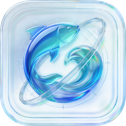
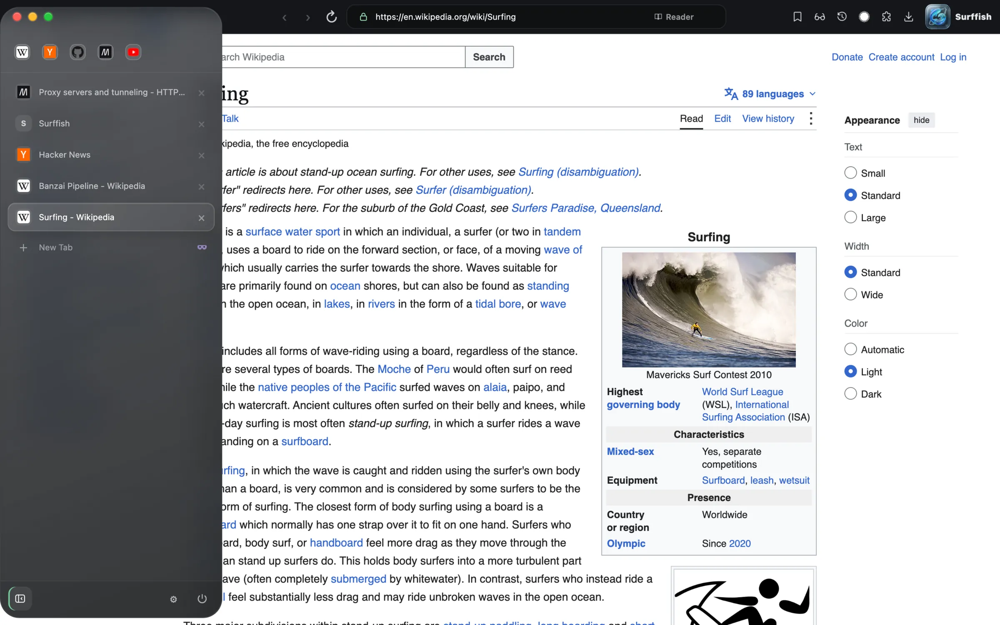
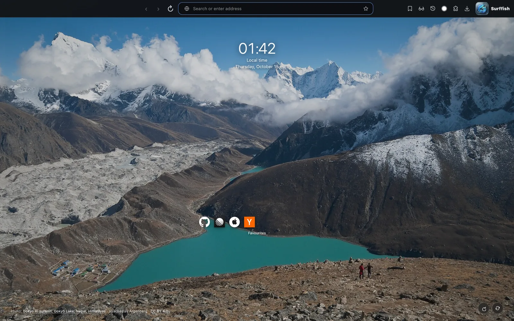
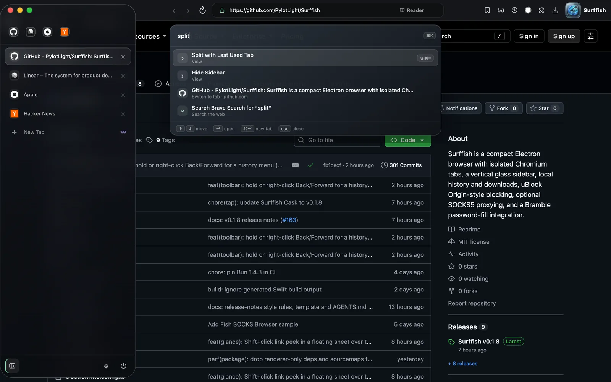
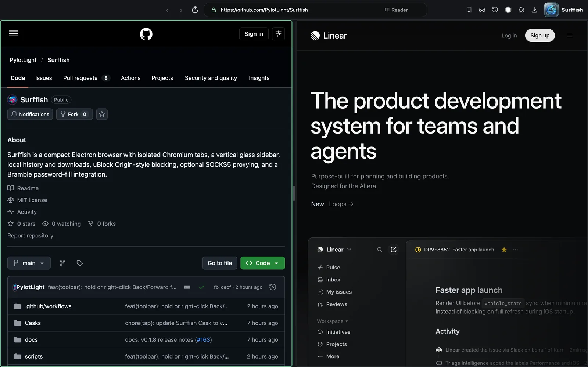
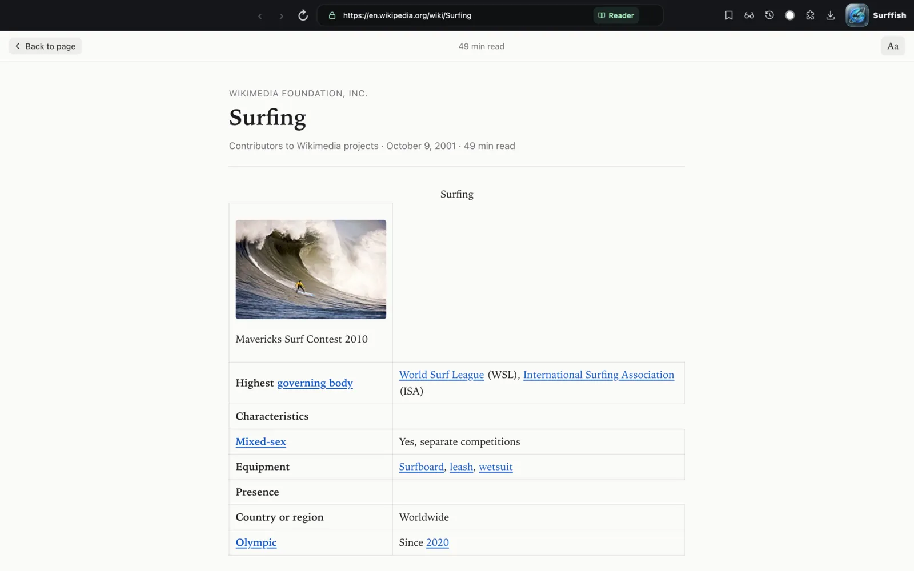
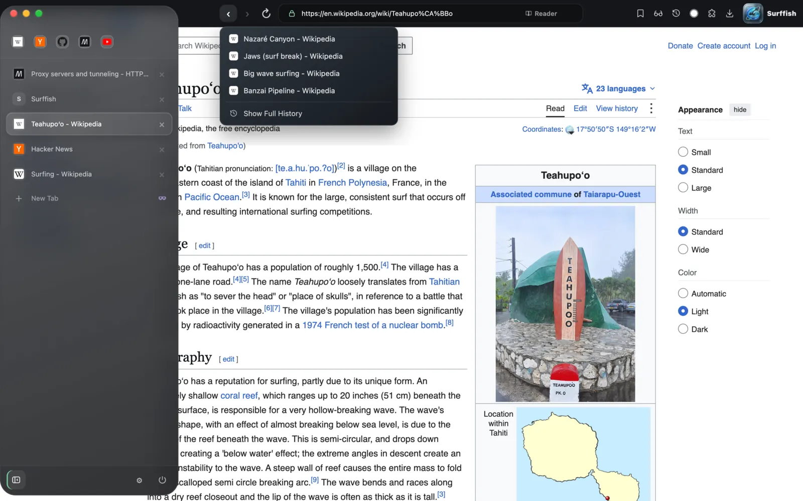
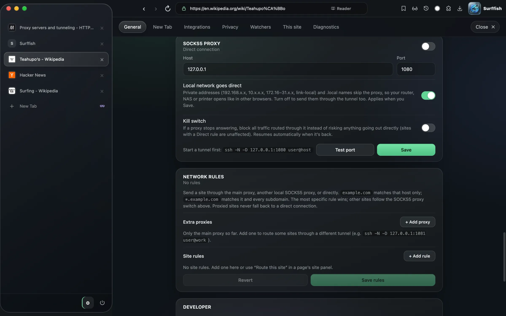

<div align="center">



# Surffish

**Surf without the noise.**

Tabs in a glass sidebar, uBlock Origin's filter lists built in, and a SOCKS5 switch for when you're on someone else's network.

[](https://github.com/PylotLight/Surffish/releases/latest)
[](#install)
[](LICENSE)
[](https://github.com/PylotLight/Surffish/actions/workflows/ci.yml)
[](https://www.electronjs.org/)
[](https://bun.sh/)

[-0A84FF?style=for-the-badge&logo=apple&logoColor=white>)](https://github.com/PylotLight/Surffish/releases/latest)
[](#install)

[Quick start](#quick-start) · [Features](#what-it-does) · [Screenshots](#screenshots) · [Install](#install) · [Privacy](#privacy) · [FAQ](#faq) · [Development](#development)

<br>



<sub>The New Tab page, with the tab sidebar card slid out over it.</sub>

</div>

<br>

Surffish is a Chromium browser (via Electron) built around one window and a sidebar. Tabs, pinned sites and tab groups live in a glass card on the left that slides in from the edge, or stays put if you pin it.

The things you'd normally add with extensions are already there: ad and tracker blocking from uBlock Origin's own lists, reader view, split view, a command palette, link previews, screenshots, a reading list, RSS feeds and page watchers. Chrome Web Store extensions still install when you want one.

It's also a quick way to browse through an SSH tunnel. Point it at a local SOCKS5 port, route only the sites you choose, and turn on a kill switch so nothing slips out direct if the tunnel drops.

## Quick start

```bash
brew tap pylotlight/surffish https://github.com/PylotLight/Surffish.git
brew install --cask surffish
```

Or grab `Surffish-<version>-mac-arm64.zip` from the [latest release](https://github.com/PylotLight/Surffish/releases/latest), unzip it and drag **Surffish.app** to Applications.

Or just run it, no install: `npx @pylotlight/surffish` (or `bunx @pylotlight/surffish`). See [Run with bunx / npx](#run-with-bunx--npx).

Surffish isn't signed or notarized yet, so the first launch needs one extra step. See [macOS says the app is damaged](#faq).

## Screenshots

<table>
  <tr>
    <td width="50%"><br><b>New Tab.</b> A rotating nature photo, the time, and your pinned and most visited sites.</td>
    <td width="50%"><br><b>Command palette (⌘K).</b> Every command, open tab and search engine in one box.</td>
  </tr>
  <tr>
    <td><br><b>Split view (⇧⌘=).</b> Two tabs side by side with a draggable divider.</td>
    <td><br><b>Reader view (⌥⌘R).</b> Just the article, with your own type size and theme.</td>
  </tr>
  <tr>
    <td><br><b>Back/Forward history.</b> Hold or right-click Back or Forward to jump several pages at once.</td>
    <td><br><b>SOCKS5 and network rules.</b> One local proxy for everything, extra proxies or Direct for specific sites, LAN addresses direct, and a kill switch.</td>
  </tr>
</table>

## What it does

| Feature                            | What you get                                                                                                                                                                                                                                                                        | Shortcut / where                                            |
| ---------------------------------- | ----------------------------------------------------------------------------------------------------------------------------------------------------------------------------------------------------------------------------------------------------------------------------------- | ----------------------------------------------------------- |
| **Sidebar tabs**                   | Vertical tabs in a glass card that reveals from the window edge. Pin it open and drag its edge to resize.                                                                                                                                                                           | Pin button at the bottom of the sidebar                     |
| **Tab groups**                     | Named, coloured groups. Cmd-click or Shift-click tabs to select several, then group, pin, move or close them together.                                                                                                                                                              | Select tabs, then ⌘G                                        |
| **Tab overview & search**          | A grid of every open tab, plus a palette that only searches tabs.                                                                                                                                                                                                                   | ⇧⌘\\ · ⇧⌘A                                                  |
| **Command palette**                | Commands, open tabs and search keywords (`yt lofi`, or a bang anywhere: `lofi !yt`) in one place.                                                                                                                                                                                   | ⌘K                                                          |
| **Split view**                     | Two tabs side by side. Swap panes, pop one out, or move focus between them.                                                                                                                                                                                                         | ⇧⌘= · ⌥⌘← / ⌥⌘→                                             |
| **Glance**                         | Shift-click a link to open it in a floating sheet over the current tab. Keep it as a real tab without reloading.                                                                                                                                                                    | Shift-click · ⌘↩ to keep                                    |
| **Mini window**                    | Pop tabs out into small windows that float above other apps (an AI chat, a video, docs; up to 6 at once), then put them back, without reloading. A global shortcut shows/hides them all, or opens a pinned page. Drag one against a screen edge to tuck it away behind a small tab. | ⇧⌘M · ⇧⌘Space                                               |
| **Ad and tracker blocking**        | uBlock Origin's default lists plus EasyList, EasyPrivacy, Peter Lowe's list and URLhaus, with cosmetic and scriptlet rules. Turn it off per site.                                                                                                                                   | On by default · per site in Settings → This site            |
| **SOCKS5 proxy**                   | Route all traffic through a local SOCKS5 port (an `ssh -D` tunnel, for example). LAN addresses go direct by default.                                                                                                                                                                | Settings → General                                          |
| **Per-site routing & kill switch** | Send specific sites through other proxies or Direct. The kill switch blocks proxied traffic if the proxy stops answering.                                                                                                                                                           | Settings → General → Network rules · This site              |
| **Private tabs & windows**         | An in-memory session that never writes history or the saved session.                                                                                                                                                                                                                | ⌥⌘N tab · ⇧⌘N window                                        |
| **Reader view**                    | The article on its own, with font, size and theme controls.                                                                                                                                                                                                                         | ⌥⌘R                                                         |
| **Reading list**                   | Save pages for later, separate from bookmarks, with an unread count.                                                                                                                                                                                                                | ⇧⌘L                                                         |
| **Read Aloud** (experimental)      | Articles, selections or a page from any point read out loud by an on-device voice model (Phonon, 37 English voices, 0.75–3×), with the spoken sentence highlighted. Off by default.                                                                                                 | ⇧⌘U · right-click → Read Aloud · [docs](docs/read-aloud.md) |
| **Bookmarks**                      | Bookmark manager, optional bookmarks bar, and import from Chrome, Brave, Edge, Arc, Firefox, Safari or an HTML export.                                                                                                                                                              | ⌘D · ⌥⌘B manager · ⇧⌘B bar                                  |
| **History**                        | Local history with search, plus a Back/Forward menu for jumping several pages.                                                                                                                                                                                                      | ⌘Y · hold or right-click Back/Forward                       |
| **Chrome Web Store extensions**    | Paste a store link, or click **Add to Surffish** on the store page. Extensions with an action get a toolbar button.                                                                                                                                                                 | Settings → Integrations → Extensions                        |
| **Bramble password manager**       | Built-in integration with the Bramble extension, with a Surffish PIN (and Touch ID) quick unlock so you don't retype the master password.                                                                                                                                           | Settings → Integrations                                     |
| **Screenshots**                    | Region, visible area, full page, or a scrolling capture you stop where you like. Copy, save or annotate.                                                                                                                                                                            | ⇧⌘S                                                         |
| **Downloads**                      | Pause, resume, open and reveal downloads from a toolbar popover.                                                                                                                                                                                                                    | ⇧⌘J                                                         |
| **PDF viewer & editor**            | Built-in viewer. Edit mode fills forms (calculations and formatting scripts included), signs signature fields with saved signatures or initials, annotates, and rotates, reorders or deletes pages, then saves or flattens a copy. Works for page-made (blob:) PDFs too.            | ⇧⌘E · ⌘S to save                                            |
| **Feeds**                          | RSS, Atom and JSON Feed reader, page feed discovery, and presets for a GitHub repo's releases, commits, tags or Actions runs.                                                                                                                                                       | Settings → Integrations → Feeds                             |
| **Page watchers**                  | Watch part of a page and get told when it changes. Can be switched off entirely.                                                                                                                                                                                                    | Settings → Watchers                                         |
| **Spaces**                         | Separate sets of tabs, each with its own cookies and proxy. Off by default.                                                                                                                                                                                                         | Settings → General → Enable Spaces · ⌃1–⌃9                  |
| **Tab sleep & auto-archive**       | Background tabs sleep after a while and old ones archive themselves (restorable). Tabs playing or paused on media are left alone.                                                                                                                                                   | Settings → General                                          |
| **Task manager**                   | CPU and memory per tab and process, and a way to kill a stuck one.                                                                                                                                                                                                                  | ⇧Esc                                                        |
| **Network inspector**              | Opt-in request log for every tab, with HAR export and request mocks. Off by default.                                                                                                                                                                                                | Settings → General → Developer                              |
| **Updates**                        | Checks the GitHub releases feed and tells you when a new version is out.                                                                                                                                                                                                            | Surffish menu → Check for Updates…                          |
| **The usual**                      | Find in page, per-site zoom, HTTPS-only mode, copy clean link (tracking parameters stripped), Picture in Picture, default browser, reopen closed tab.                                                                                                                               | ⌘F · ⌘= / ⌘- · ⌥⇧⌘C · ⇧⌘T                                   |

Shortcuts are the macOS ones. Running from source on Linux, ⌘ is Ctrl (History is Ctrl+H, Downloads Ctrl+J).

## Install

Surffish ships as an Apple silicon zip on [GitHub Releases](https://github.com/PylotLight/Surffish/releases), and this repo is its own Homebrew tap. It needs macOS 13 Ventura or newer on an M-series Mac.

**Homebrew** (recommended, updates with `brew upgrade`):

```bash
brew tap pylotlight/surffish https://github.com/PylotLight/Surffish.git
brew install --cask surffish
```

**Manual:** download `Surffish-<version>-mac-arm64.zip` from the [latest release](https://github.com/PylotLight/Surffish/releases/latest), unzip, and move **Surffish.app** to `/Applications`.

There are no Intel Mac, Windows or Linux builds. The app runs from source on Linux for development and CI.

### Run with bunx / npx

```bash
npx @pylotlight/surffish        # or: bunx @pylotlight/surffish
```

The [`@pylotlight/surffish`](https://www.npmjs.com/package/@pylotlight/surffish) package is a tiny launcher (no dependencies). The first run downloads the release zip from GitHub Releases (about 120 MB) with a progress bar, checks its SHA-256 against the one recorded when the package was published, unpacks it with `ditto` into `~/.cache/surffish/<version>` and opens it. Later runs open the cached copy straight away, offline too.

- `npx @pylotlight/surffish@0.1.22` runs that exact release; the package version always matches the app version.
- `--latest` runs the newest GitHub release instead, `--path` prints the cached `.app` path, `--clear-cache` frees the space, `--help` lists the rest. Anything else (a URL, say) is passed to the app.
- `npm i -g @pylotlight/surffish` gives you a `surffish` command.
- The cache respects `XDG_CACHE_HOME`. Homebrew is still the better choice if you want `/Applications` and `brew upgrade`.
- `bunx @pylotlight/surffish --uninstall` removes the cached app and prints what else is left (your profile, caches, keychain item); `--uninstall --all` deletes those too, after asking.

Same platform limits as above: Apple silicon Macs only. On other systems the launcher says so and exits. More in [packages/cli/README.md](packages/cli/README.md).

## Privacy

- **Your data stays on your Mac.** History, the open-tabs session, bookmarks, the reading list and preferences live in one SQLite database (`surffish.db`) in your profile folder. There's no account and no sync service.
- **Address bar suggestions are local.** They come from your own tabs, bookmarks and history, not from a remote suggestion service. Typed searches go to the search engine you pick.
- **Network calls Surffish makes on its own:** filter list updates (from uBlock Origin's asset server and the list publishers, at startup when stale and then every 8 hours), New Tab photos, the GitHub releases feed for update checks, and any feeds or page watchers you add. Turning on Read Aloud downloads its voice model once (pinned, hash-checked); the text it reads never leaves your Mac. Preloading (on by default, Settings → General → Tabs) opens a connection to a site while you type its address or hover a link to it, never in private tabs.
- **The proxy is a tunnel, not anonymity.** SOCKS5 support routes traffic through an endpoint you control. It's not an audited anonymity tool. WebRTC is kept from leaking your real IP while the proxy is on.

Translation is optional and online. Settings → Languages holds the target language. Translate page updates readable text in the current page; Translate Selection shows a small in-page result. Show original restores unchanged translated text without reloading. Only a requested snapshot of readable text is sent to Google, without site cookies; form values, editable fields, hidden text and code blocks are excluded. Local/private addresses are not translated. This uses Google’s keyless web endpoint, which may be rate-limited or change without notice; no API key is required and availability is not guaranteed. The explicit Open in Google Translate fallback still opens a separate tab and shares the page URL. Source language is detected automatically. Translation covers the main document, not frames, PDFs or text inside shadow roots; large pages may be partially translated, and newly loaded content requires another request.

## FAQ

<details>
<summary><b>macOS says Surffish "is damaged and can't be opened"</b></summary>

<br>

Surffish is unsigned and not notarized, so Gatekeeper blocks a downloaded copy. First make sure it came from the [official releases](https://github.com/PylotLight/Surffish/releases). Then clear the quarantine flag and open it again:

```bash
xattr -cr /Applications/Surffish.app
```

You can also Control-click the app and choose **Open** on first launch. Clearing quarantine skips Gatekeeper's download check, so only do it for a copy you trust. Homebrew no longer has a `--no-quarantine` option, so the same step applies to Cask installs.

</details>

<details>
<summary><b>How do I browse through an SSH tunnel?</b></summary>

<br>

Surffish can start an SSH tunnel for you. In **Settings → Connection → SOCKS5 proxy**, enter a host alias from `~/.ssh/config` (or `user@host`) and Save. Surffish and other local apps then share the SOCKS5 endpoint `127.0.0.1:1088`; Surffish selects the SSH-side port automatically.

To use an SSH tunnel you already started yourself, open a dynamic forward in a terminal and leave it running:

```bash
ssh -N -D 127.0.0.1:1080 user@your-ssh-host
```

Then go to **Settings → Connection → SOCKS5 proxy**, leave the SSH host field blank, set the host and port (`127.0.0.1` and `1080` by default), and turn the switch on. Other apps can use the helper at `127.0.0.1:1088`. **Test port** only checks that something is listening; it doesn't test the SOCKS handshake or the SSH destination.

To send only some sites through the tunnel, leave the main switch off and add **Network rules** instead, or open the **This site** panel on a page and pick a route. Turn on **Kill switch** if a proxied site should fail closed when the tunnel drops.

</details>

<details>
<summary><b>Do Chrome extensions work?</b></summary>

<br>

Many do. Install from **Settings → Integrations → Extensions** by pasting a Chrome Web Store link or ID, or click **Add to Surffish** on the store page. Surffish shims the APIs Electron is missing (tab events, `declarativeNetRequest` rules, `webNavigation` and so on), and lists anything only partly supported. Extensions that rely on Chrome-only APIs, or on Chrome's sign-in, may not work.

</details>

<details>
<summary><b>Where is my data stored?</b></summary>

<br>

In `~/Library/Application Support/Surffish`. The main file is `surffish.db` (SQLite, with `-wal`/`-shm` next to it), with small JSON files for some settings. Delete the folder to reset Surffish completely. Dev builds use a separate `Surffish Dev` folder, so they can run alongside the installed app.

</details>

<details>
<summary><b>Why Electron and not a "real" browser fork?</b></summary>

<br>

Electron gives a current Chromium engine with a small, readable codebase on top, so features land quickly and the whole app stays hackable in TypeScript. The trade-off is that a few Chrome features (Chrome sync, some extension APIs) aren't available.

</details>

## Documentation

- [Development](docs/development.md): setup, scripts, smoke tests, Electron gotchas
- [Architecture](docs/architecture.md): main process, renderer surfaces, how the window is put together
- [Profile storage](docs/storage.md): the `surffish.db` schema and JSON fallbacks
- [Bramble quick unlock](docs/bramble-quick-unlock.md): how the PIN and Touch ID unlock works
- [Performance checks](docs/perf.md): what the per-PR perf job measures
- [Read Aloud](docs/read-aloud.md): the on-device voice, its downloads and memory
- [Troubleshooting](docs/troubleshooting.md)
- [Releasing](docs/releasing.md) and [release notes](docs/releases/)
- [Third-party assets](docs/third-party-assets.md)

## Development

You need [Bun](https://bun.sh/) (version pinned in `.bun-version`).

```bash
git clone https://github.com/PylotLight/Surffish.git
cd Surffish
bun install
bun run dev
```

`bun run test` runs the unit tests, `bun run typecheck` type-checks, and the `test:electron-*` scripts run Electron smoke tests against a production build. More in [docs/development.md](docs/development.md).

## Contributing

Issues and PRs are welcome. Keep PRs to one change, and include a smoke test or screenshot for UI changes. CI runs on self-hosted runners and doesn't run for pull requests from forks, so a maintainer will run it for you.

## License

[MIT](LICENSE). Third-party assets (the Bramble icon, New Tab photos) carry their own licenses, listed in [docs/third-party-assets.md](docs/third-party-assets.md).

<br>

<div align="center">
<sub>If Surffish makes your browsing a bit quieter, a ⭐ helps other people find it.</sub>
</div>
