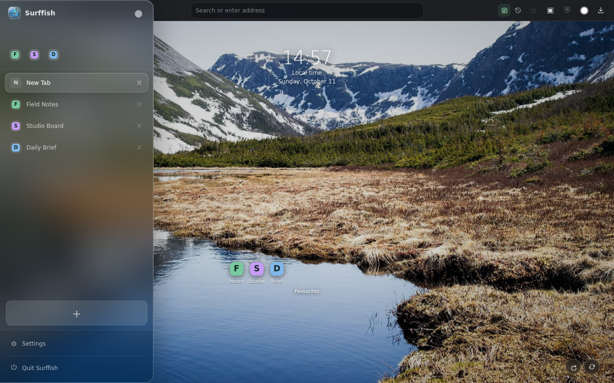

# Surffish



**A calmer desktop browser.** Surffish brings your tabs, favorite sites, and everyday browsing tools together in one focused workspace.

## Browse your way

- **A sidebar that fits:** keep tabs and favorites close, reveal the sidebar from the edge, or pin it open. Drag its edge to choose a width that feels right.
- **A fresh New Tab:** enjoy nature photography, local time, and quick links to your favorite and frequently visited sites.
- **Everyday tools built in:** search suggestions, browsing history, downloads, ad and tracker blocking, Picture in Picture, and optional SOCKS5 proxy support.

Your favorites, history, and preferences are stored locally. Address suggestions are based on your own tabs, favorites, and history—not a remote suggestion service. Surffish is an actively developing browser; its privacy and proxy features are not an audited anonymity service.

## Install on macOS

Surffish ships as an Apple silicon zip on [GitHub Releases](https://github.com/PylotLight/Surffish/releases), and this repository doubles as its Homebrew tap:

```bash
brew tap pylotlight/surffish https://github.com/PylotLight/Surffish.git
brew install --cask surffish
```

Surffish is an unsigned, non-notarized app. If macOS blocks a downloaded copy with a “damaged” warning, first make sure it came from the official [Surffish releases](https://github.com/PylotLight/Surffish/releases) and that you trust it. Then remove the quarantine attribute and open the app again:

```bash
xattr -cr /Applications/Surffish.app
```

You can also Control-click the app and choose **Open** on first launch. Clearing quarantine bypasses that Gatekeeper download check; do it only for a copy you trust. Homebrew no longer provides a `--no-quarantine` install option.

For development setup, architecture, and technical notes, see the [developer documentation](docs/development.md). Release and packaging notes are in [docs/releasing.md](docs/releasing.md).
