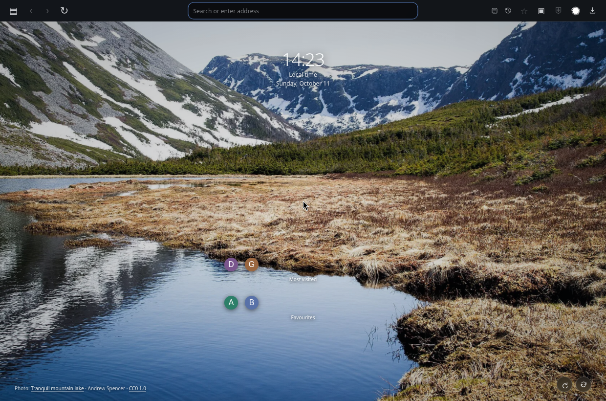
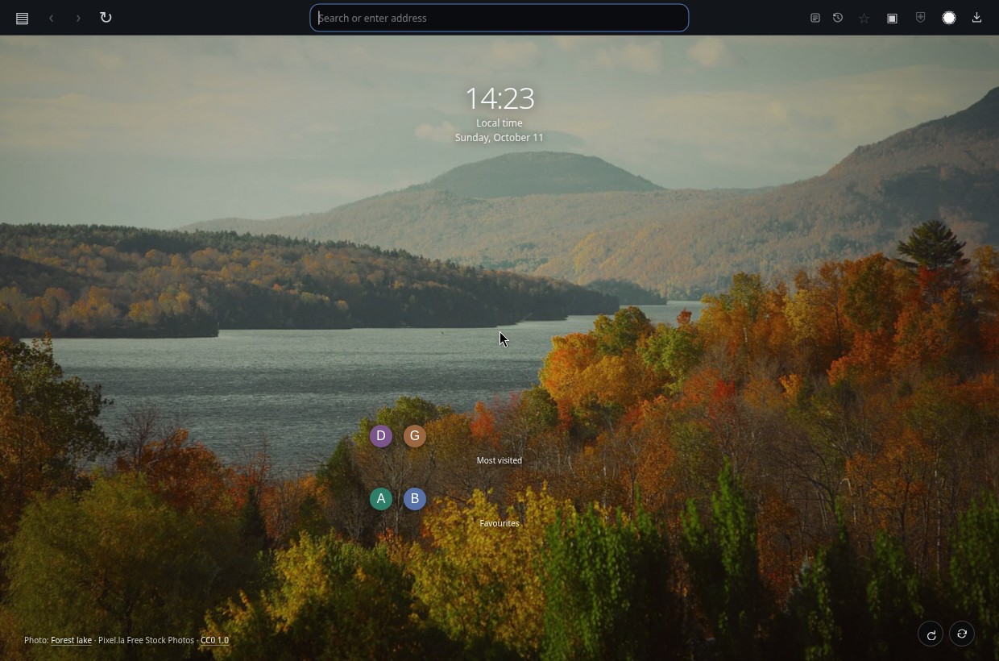
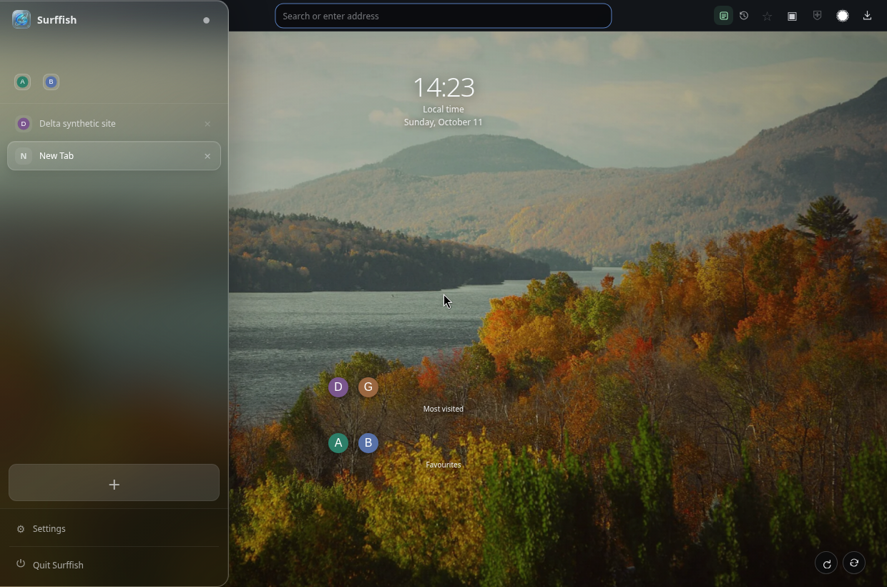
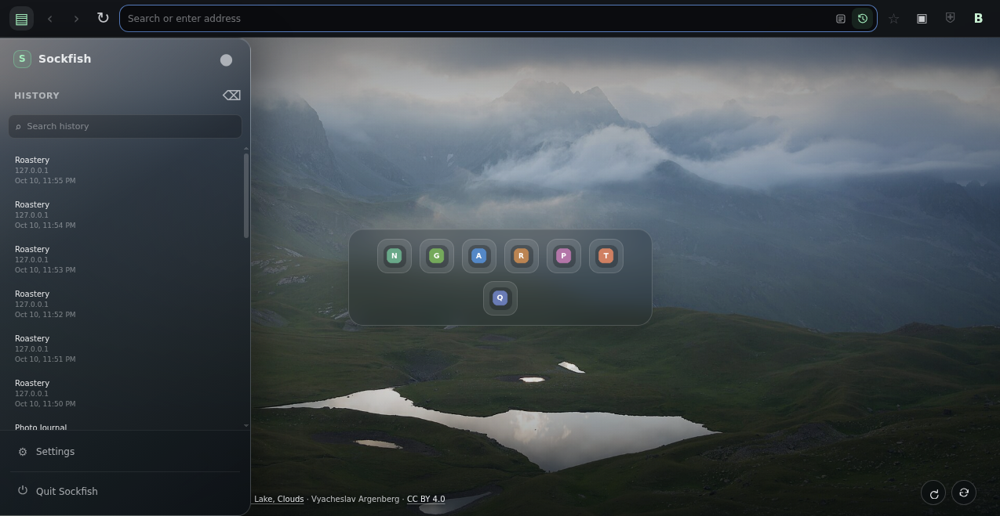
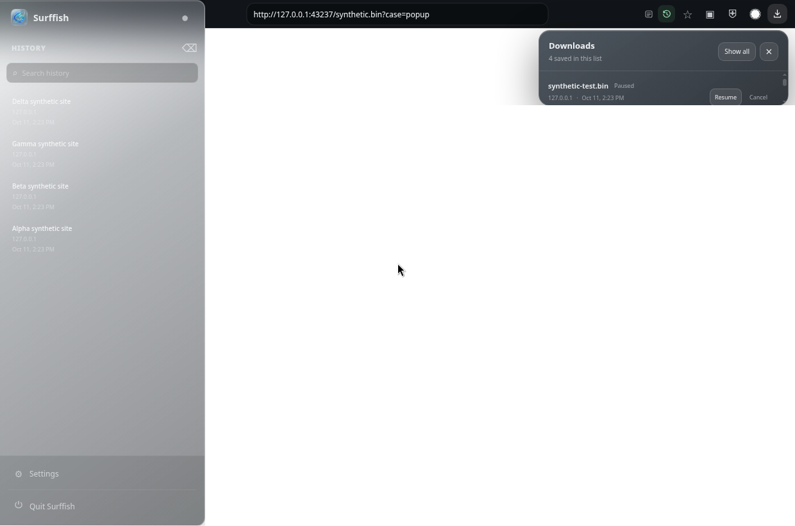
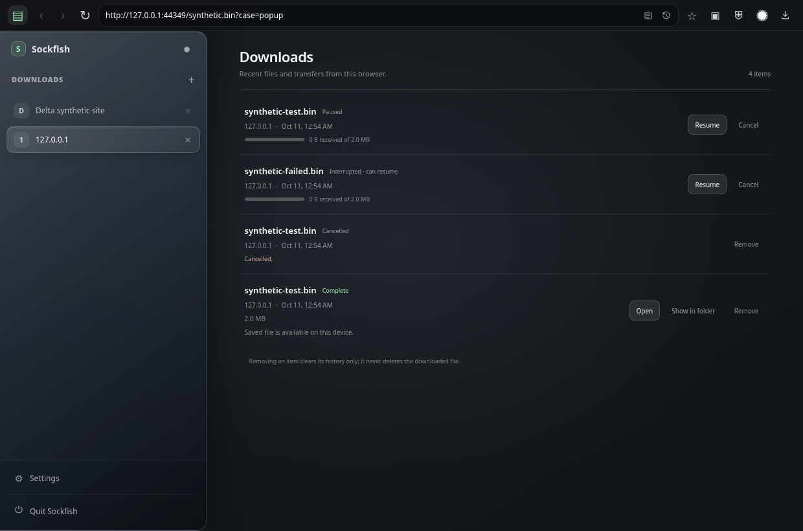
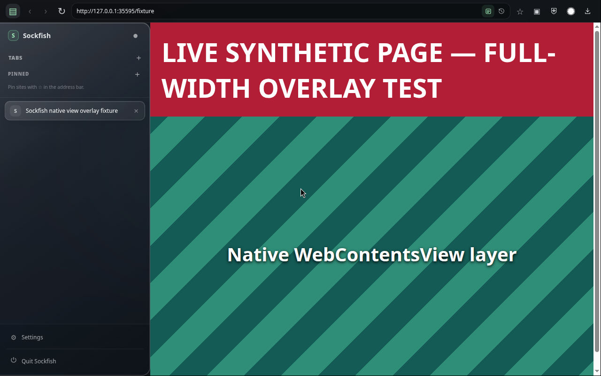
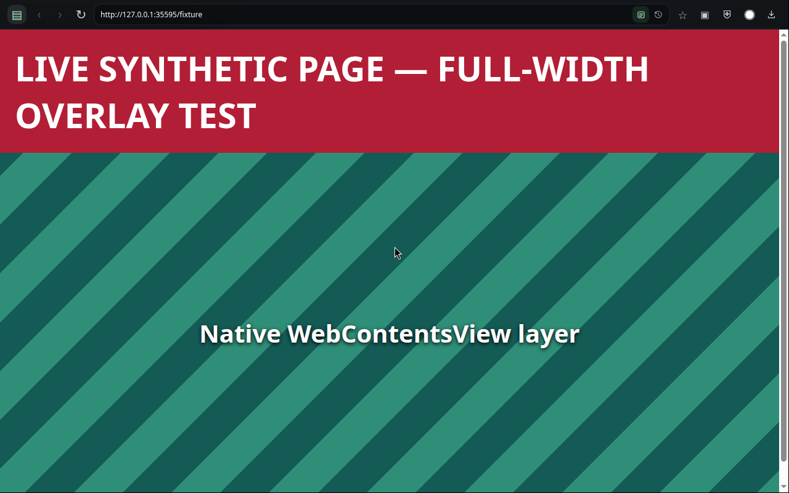

# Browser UI overhaul

This release gives Sockfish a more complete browser shell while keeping the existing Chromium profile, stored tabs/history, proxy, network blocker, Network inspector, Bramble toolbar shortcut, and extension behavior intact. It adds an Electron-backed Downloads popup and history page. The Diagnostics page and renderer runtime-compatibility card are removed; Electron's native Web inspector remains available.

Fresh profiles use a direct connection by default so the start page loads without requiring a local SOCKS tunnel. An explicitly saved proxy choice remains authoritative; enable and save SOCKS5 in **Settings → General** when desired.

## New tabs, pins, and address suggestions

- Fresh profiles open the browser-owned **New Tab** page, rendered locally as a full-window photo with a smaller, lower-set frosted-glass grid of favicon icons in the compact Quick Links style. It has no large tile cards or separate bookmark database. **Settings → General → New tab page** also offers [Bonjourr's hosted start page](https://online.bonjourr.fr/) and the selected search engine.
- Pinned sites appear first in the icon grid; up to eight frequently visited, unpinned origins follow, derived from Sockfish's local history. Both lists remain on-device. Clicking an icon opens its site. New Tab and sidebar favicons are requested directly from each site's `/favicon.ico` with `no-referrer`, with a letter fallback if unavailable. Pins appear as a compact horizontally scrollable icon strip in the sidebar; right-click still unpins. Clearing history removes the derived frequent icons.
- The two active backgrounds rotate every 15 minutes. **Next background** skips immediately; **Refresh nature photos** asks for a new set. While the local New Tab is in use, Sockfish performs two fixed mountain-lake/forest-lake Wikimedia Commons searches at most once every 24 hours; a manual refresh is separately available. Requests use the existing browser session and saved proxy setting, omit cookies/referrers, and contain no browsing history, pins, or visited URLs. Only declared CC0 or attribution-only CC BY photo metadata is accepted, and no more than two remote thumbnails are cached with their credits for offline use. If a request fails, the current cache or two bundled CC0 fallback photos remain. The visible title, creator, source, and license are linked; see [New Tab photo-source and cache notes](new-tab-photo-sources.md).
- Bonjourr's **Quick Links** extension can import browser bookmark groups and, where browser APIs permit, Most Visited links; its documented default favicon mode uses Bonjourr's favicon-fetcher service ([official Quick Links docs](https://bonjourr.fr/docs/widgets/quick-links/)). Sockfish does not install that extension or expose browser bookmark import APIs in its hosted-page integration. Sockfish's compact grid is its local alternative: pinned favorites plus a local-history list, with no history sent to Bonjourr or a favicon service.
- Address suggestions are generated locally from pins, open tabs, and browsing history. The query is not sent to a remote autocomplete service. Arrow keys and Enter select a suggestion; Escape closes the list. Unsafe schemes and credential-bearing URLs are excluded.

## Sidebar and tabs

- The left sidebar is a full-height frosted-glass panel with a low-opacity tinted fill, soft blur and saturation, and a fine bright edge. On the renderer-owned New Tab, the scenic image is visible through the glass. Live websites are separate native Electron `WebContentsView`s positioned beside the sidebar, so their pixels do not appear under it; see the [measured overlay limitation and implementation option](sidebar-overlay-limitation.md). The smooth slide, close controls, reveal strip, pinning, and pinned-site favicons remain in place.
- Tabs and History navigation are compact, labeled, keyboard-focusable icons inside the address field; the sidebar footer keeps Settings and Quit. General, This site, and Network live in the settings workspace so configuration is not mixed into the tab list. The separate Network inspector is preserved; the native Electron Web inspector remains available for deeper Chromium inspection. The Bramble toolbar button still runs its existing popup/password-fill flow.
- An explicitly opened tab loads immediately, including a background tab. The previously active restored tab automatically resumes at launch; other restored tabs may remain deferred until selected. The active-tab “Load page” sleep screen has been removed.
- The existing hibernation policy remains for inactive loaded tabs. Ordinary background media keeps playing, and audible tabs are kept awake. Hibernated tabs reload their last URL on activation; this cannot preserve unsaved form contents or in-page state.

## Browser and site controls

- The toolbar includes back, forward, reload/stop, favorite, Picture in Picture, site settings, the official circular Bramble icon, and Downloads. The Bramble shortcut and its extension behavior are unchanged; the exact dark-toolbar icon comes from the official extension repository (see [asset attribution and license](third-party-assets.md)).
- Downloads opens an anchored popup with recent and in-progress items. **Show all** opens the full Downloads page. Rows include filename, source host, date, size, and state, with pause/resume/cancel where Electron supports the action. Completed files can be opened only on an explicit click or revealed in the file manager. Removing a history entry never deletes its file; no file contents are stored in the UI or logs.
- Picture in Picture uses Chromium's standard `HTMLVideoElement.requestPictureInPicture()` path, which opens a separate floating player window when the page/browser platform supports it. It chooses the active, ready video (or the first ready video); failure is reported rather than silently changing the page.
- **Settings → This site** stores choices by normalized HTTP(S) origin: network ad blocking, routing pop-ups into tabs, camera/microphone requests, geolocation, and notifications. Web permissions remain denied unless explicitly granted per site; the operating system can still require its own camera/microphone approval. Reload after changing ad blocking or a permission if the active page has already cached a decision.
- These controls are intentionally narrower than a complete browser permission center. They do not promise per-site JavaScript/cookie controls, cosmetic filtering, or macOS-level entitlements.

## Bramble passkeys and macOS Touch ID

The app no longer presents a separate renderer diagnostics page or a user-facing WebAuthn compatibility card. The Bramble toolbar shortcut and extension popup remain intact. Bramble's extension custom-RP-ID passkey registration requires a sufficiently recent extension-capable browser build (its documented Chromium floor is Chrome 122). That version check is only one condition: a `SecurityError`, rejected relying-party ID, or missing extension host permission can produce the same “browser too old” message. The Network inspector remains a separate app panel; Electron's native Web inspector is available for low-level investigation.

Native macOS Touch ID for arbitrary website passkeys depends on Apple's managed browser public-key-credential entitlement, app signing, and Apple's organization review ([entitlement documentation](https://developer.apple.com/documentation/bundleresources/entitlements/com.apple.developer.web-browser.public-key-credential)). Sockfish does not claim to have that entitlement or require Apple Developer enrollment/signing as part of this UI work. This is separate from Touch ID used to unlock an extension vault, where supported by that extension/runtime.

## Verification

Real app screenshots (Linux Electron build; complete Sockfish window bounds; synthetic local sites/history/download records, not mockups):

- 
- 
- 
- 
- 
- 
- 
- 
- 

The screenshots verify the Linux-rendered app UI. They do not verify macOS-native titlebar or traffic-light integration.

Run:

```bash
bun run typecheck
bun run test
bun run build
xvfb-run -a bun run test:electron-downloads
xvfb-run -a bun run test:electron-sidebar-overlay
```

Manual smoke checklist:

1. Launch with a clean profile and confirm a new tab opens the local photo page with only a small, low-set frosted-glass icon grid. Verify pinned Favorites come first, frequent origins come only from local history, and site icons load from their own origin or fall back to a letter. Check the photo/license credits, **Next background**, and **Refresh nature photos**. Confirm Commons receives only generic search requests, no history/pins/URLs or cookies, and the cache remains limited to two remote images. Switch to Bonjourr or Search engine and verify the next tab uses that choice.
2. Open a foreground and background tab; verify both begin loading immediately. Restart with several tabs and verify the selected tab loads automatically while inactive restored tabs load when selected.
3. Confirm an audible/background media tab continues playing and is not hibernated while audible.
4. Use the address-field Tabs and History icons; verify their accessible names/tooltips, keyboard focus, sidebar contents, hover reveal, and pinned favicon strip. Open Settings from the sidebar footer.
5. Pin a site, open it from a New Tab favorite icon, the pinned sidebar icon, and local autocomplete, then remove it; verify frequent icons and address suggestions use only local history/tabs/pins.
6. Change site ad blocking and permission choices for a test origin; verify other origins retain their defaults. Verify pop-ups stay blocked unless “Open pop-ups in tabs” is enabled for that site. Confirm the Network inspector and native Electron Web inspector remain available; no Diagnostics page/card is shown.
7. On a page with a ready video, click Picture in Picture and verify the floating player can be toggled off; on a page without video, verify an explanatory message appears.
8. Use a local synthetic attachment to verify Downloads progress, pause/resume, cancel, complete, failed, Open, Show in folder, and remove-from-list behavior. Confirm files never open automatically and removing history leaves the saved file intact. Open the toolbar popup with the keyboard, dismiss with Escape, and navigate to the full page.
